# Análisis y flujo secuencial: integración por sumas de Riemann

| Campo | Definición de esta entrega |
|---|---|
| Nombre del algoritmo elegido | Integración numérica por sumas de Riemann, variante de la regla del punto medio compuesta. |
| Justificación de la selección | Cada rectángulo evalúa la misma función en un punto independiente; permite repartir evaluaciones entre hilos CUDA y estudiar el costo de la reducción y las transferencias. Además, la integral en `[0,1]` tiene el valor conocido `π`, útil como referencia de convergencia. |
| Función y dominio | `f(x) = 4/(1+x²)`; intervalo `[a,b]=[0,1]`; integral exacta `π`. |
| Datos de entrada | Una instancia de `IntegrationInput` con tres escalares: `a` y `b` finitos, con `a < b`, y `n` entero positivo, excluyendo booleanos. Los casos elegidos usan `[a,b]=[0,1]` y `n ∈ {1, 2, 4, 10 000, 100 000, 1 000 000}`. En CPU son objetos `float` e `int` de Python; se prevén `float64` e entero de 64 bits para GPU. No se almacena un vector de puntos. `src/data.py` define las entradas compartidas. |
| Datos de salida | Un único `float` de Python (doble precisión), aproximación de la integral; se prevé `float64` en GPU. No se devuelve un vector. Para `[0,1]` converge a `π` al aumentar `n`, pero no tiene que ser exactamente igual a `π` para un `n` finito. |
| Operaciones y procesos | Validar los parámetros al construir `IntegrationInput`; calcular `Δx=(b-a)/n`; inicializar `total=0`; recorrer `i=0,...,n-1`, calcular `x_i=a+(i+0.5)Δx`, evaluar `4/(1+x_i²)` y acumular en `total`; devolver `total·Δx`. El ciclo termina después de `n` iteraciones. |
| Dependencia | Cada evaluación es independiente; el acumulador `total` depende de todas las iteraciones previas. En GPU se necesitará una reducción correcta, a diseñar por el integrante 2. |

La CPU hace la suma en orden ascendente de `i`, sin `numpy.sum`, funciones de
integración de bibliotecas ni ejecución paralela. El algoritmo realiza `n`
evaluaciones y usa memoria adicional constante. En una GPU, las evaluaciones
pueden ejecutarse en paralelo, pero las sumas de punto flotante pueden diferir
levemente si cambia el orden de acumulación.

## Diagrama de flujo de la implementación real

```mermaid
flowchart TD
    A[Construir IntegrationInput con a, b, n] --> B{¿n entero positivo no booleano y extremos finitos con a menor que b?}
    B -- No --> C[Rechazar entrada con ValueError]
    B -- Sí --> D[Calcular width = b-a dividido entre n]
    D --> E[Inicializar total = 0.0 e i = 0]
    E --> F{¿i < n?}
    F -- Sí --> G[Calcular x = a + &#40;i + 0.5&#41; * width]
    G --> H[Evaluar 4 dividido entre 1+x²]
    H --> I[Acumular en total e incrementar i]
    I --> F
    F -- No --> J[Devolver total por width]
    C --> K[Fin con error]
    J --> L[Fin]
```

La validación pertenece a `IntegrationInput.__post_init__` en `src/data.py`;
`run_sequential` recibe una instancia ya construida. El índice `i` y su
incremento representan el recorrido de `for i in range(inputs.n)` en
`src/sequential.py`. No hay generación de datos ni impresión dentro del cálculo.

## Oportunidades SIMD y dependencias (paso 2.3)

La operación repetida es calcular el punto medio `x_i` y evaluar
`f(x_i)=4/(1+x_i*x_i)` para cada uno de los `n` subintervalos. Todas las
iteraciones aplican las mismas operaciones aritméticas a índices distintos y
solo leen los parámetros comunes `a`, `b` y `n`. Por tanto, las evaluaciones
son independientes y presentan una oportunidad de paralelismo de datos SIMD.
En CUDA este trabajo se expresa mediante el modelo SIMT: varios hilos ejecutan
la misma secuencia sobre índices diferentes.

La dependencia está en `total += f(x_i)`: en CPU, cada actualización utiliza
el valor acumulado por la iteración anterior. Si varios hilos escribieran
directamente sobre el mismo acumulador sin coordinación, se podrían perder
contribuciones. La suma requiere una reducción o algún mecanismo de
acumulación correcto; el integrante 2 definirá esa solución y la organización
de los hilos. El cálculo de `width` precede a las evaluaciones y la
multiplicación final espera a que termine la suma.

La GPU podría distribuir las evaluaciones entre muchos hilos, especialmente
para valores grandes de `n`. La conveniencia dependerá del costo de lanzar el
kernel, transferir datos y combinar los resultados; esta fase no demuestra una
aceleración. Cambiar el orden de suma también puede introducir diferencias de
redondeo, por lo que la comparación CPU/GPU deberá usar una tolerancia
justificada, además de conservar la misma regla de integración y precisión.

## Casos y tamaño de datos

| Uso | `n` | Cantidad de datos procesados | Dimensiones | Memoria mínima de parámetros |
|---|---:|---:|---|---:|
| Comprobación manual | 1, 2, 4 | 1, 2, 4 evaluaciones | Tres escalares por caso | 24 bytes por caso |
| Rendimiento, pequeño | 10 000 | 10 000 evaluaciones | Tres escalares | 24 bytes |
| Rendimiento, mediano | 100 000 | 100 000 evaluaciones | Tres escalares | 24 bytes |
| Rendimiento, grande | 1 000 000 | 1 000 000 evaluaciones | Tres escalares | 24 bytes |

Los 24 bytes son el formato mínimo previsto: `a` (8), `b` (8) y `n` (8). La
implementación Python usa objetos, cuyo consumo real en RAM es mayor y depende
del intérprete. No existe un arreglo de `n` valores en CPU: los puntos se
calculan uno a uno. El integrante 2 decidirá el espacio de resultados parciales
en VRAM, que no forma parte de estos 24 bytes. Las seis entradas definidas suman
144 bytes de parámetros en ese formato; se procesan individualmente.

La función `f` no utiliza aleatoriedad; por tanto, no se requiere semilla. El
caso `n=1` produce `3.2`; `n=2` permite una suma manual y los casos crecientes
se acercan a `π`. La prueba CPU se ejecuta con
`python -m unittest discover -s tests -v` desde la raíz del proyecto.

## Punto de traspaso

Usar exactamente los casos de `src.data` y la fórmula descrita. El cálculo de
GPU, las transferencias y sus tiempos se registrarán en fases posteriores. El
entorno local quedó preparado en `.venv`, como se indica en `README.md`.
