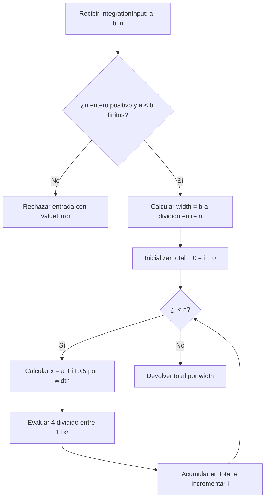

# Análisis y flujo secuencial: integración por sumas de Riemann

| Campo | Definición de esta entrega |
|---|---|
| Nombre | Integración numérica por sumas de Riemann, regla del punto medio |
| Justificación | Cada rectángulo evalúa la misma función en un punto independiente; permite repartir evaluaciones entre hilos CUDA y estudiar el costo de la reducción y las transferencias. |
| Función y dominio | `f(x) = 4/(1+x²)`; intervalo `[a,b]=[0,1]`; integral exacta `π`. |
| Entradas | Tres escalares: `a` y `b` como `float64`, `n` entero positivo de 64 bits para el intercambio previsto con GPU. `src/data.py` mantiene los casos idénticos para CPU y GPU. |
| Salida | Un escalar `float64`: aproximación de la integral. |
| Operaciones | `Δx=(b-a)/n`; para `i=0,...,n-1`, calcular `x_i=a+(i+0.5)Δx`, evaluar `4/(1+x_i²)` y sumar; multiplicar la suma por `Δx`. |
| Dependencia | Cada evaluación es independiente; el acumulador `total` depende de todas las iteraciones previas. En GPU se necesitará una reducción correcta, a diseñar por el integrante 2. |

La CPU hace la suma en orden ascendente de `i`, sin `numpy.sum`, funciones de
integración de bibliotecas ni ejecución paralela. El algoritmo realiza `n`
evaluaciones y usa memoria adicional constante. En una GPU, las evaluaciones
pueden ejecutarse en paralelo, pero las sumas de punto flotante pueden diferir
levemente si cambia el orden de acumulación.

## Diagrama de flujo de la implementación real

## Casos y tamaño de datos

| Uso | `n` | Cantidad de datos procesados | Dimensiones | Memoria mínima de parámetros |
|---|---:|---:|---|---:|
| Comprobación manual | 1, 2, 4 | 1, 2, 4 evaluaciones | Tres escalares por caso | 24 bytes por caso |
| Rendimiento, pequeño | 10 000 | 10 000 evaluaciones | Tres escalares | 24 bytes |
| Rendimiento, mediano | 100 000 | 100 000 evaluaciones | Tres escalares | 24 bytes |
| Rendimiento, grande | 1 000 000 | 1 000 000 evaluaciones | Tres escalares | 24 bytes |

Los 24 bytes son el formato mínimo previsto: `a` (8), `b` (8) y `n` (8). La
implementación Python usa objetos, cuyo consumo real en RAM es mayor y depende
del intérprete. No existe un arreglo de `n` valores en CPU: los puntos se
calculan uno a uno. El integrante 2 decidirá el espacio de resultados parciales
en VRAM, que no forma parte de estos 24 bytes. Las seis entradas definidas suman
144 bytes de parámetros en ese formato; se procesan individualmente.

La función `f` no utiliza aleatoriedad; por tanto, no se requiere semilla. El
caso `n=1` produce `3.2`; `n=2` permite una suma manual y los casos crecientes
se acercan a `π`. La prueba CPU se ejecuta con
`python -m unittest discover -s tests -v` desde la raíz del proyecto.

## Punto de traspaso

Usar exactamente los casos de `src.data` y la fórmula descrita. El cálculo de
GPU, las transferencias y sus tiempos se registrarán en fases posteriores. El
entorno local quedó preparado en `.venv`, como se indica en `README.md`.
