# Informe final — Paralelizando algoritmos con CUDA

**Curso:** CC3069, Computación Paralela y Distribuida, UVG  
**Algoritmo:** integración numérica por sumas de Riemann (regla del punto medio)  
**Función:** \(f(x)=4/(1+x^2)\) en \([0,1]\); valor exacto \(\pi\)  
**Fuente de mediciones:** `results/20261029T015937Z/` (GPU real; no inventadas)

---

## 1. Introducción y objetivo

Se implementó la misma regla del punto medio en CPU (Python secuencial) y en
GPU (Numba CUDA), se validó la equivalencia numérica y se midió el speedup
**de extremo a extremo**, incluyendo transferencias Host↔Device y la reserva
de buffers en VRAM.

## 2. Algoritmo seleccionado y justificación

Se eligió la integración por sumas de Riemann porque:

- cada evaluación \(f(x_i)\) es independiente (buen candidato SIMT);
- la dependencia está solo en la reducción final;
- no requiere materializar un vector de \(n\) puntos;
- el valor exacto \(\pi\) sirve como referencia de convergencia.

Detalle completo: `docs/flujo_secuencial.md`.

## 3. Entorno de trabajo

| Pregunta | Respuesta |
|---|---|
| ¿Funcionó el setup local? | Sí. Se usó equipo local con GPU NVIDIA; no Colab. |
| Sistema de las corridas | Windows 11 (build 26200), Python 3.14.0 |
| GPU | NVIDIA GeForce RTX 3050 6GB Laptop, CC 8.6 |
| Controlador / CUDA | Driver 592.82 (anuncia CUDA 13.1); runtime de paquetes CUDA 12.9 |
| Paquetes | NumPy 2.3.5, Numba 0.68.1, Numba-CUDA 0.30.4 |
| Evidencia | `README.md`, `results/20261029T015937Z/environment.json` |

Problema resuelto en la preparación: NumPy 2.5.x rompía la compilación de
Numba-CUDA (`numpy.row_stack`); se fijó NumPy 2.3.5 en `requirements.txt`.

## 4. Análisis secuencial

| Campo | Contenido |
|---|---|
| Nombre | Sumas de Riemann, regla del punto medio compuesta |
| Entrada | `IntegrationInput(a, b, n)` — tres escalares |
| Salida | Un `float` (doble precisión), aproximación de la integral |
| Operaciones | \(\Delta x=(b-a)/n\); para \(i=0..n-1\): \(x_i=a+(i+0.5)\Delta x\), acumular \(f(x_i)\); devolver \(total\cdot\Delta x\) |
| Dependencias | Evaluaciones independientes; el acumulador es una reducción |

Diagrama Mermaid de la implementación real:

```mermaid
flowchart TD
    A[Construir IntegrationInput a, b, n] --> B{¿n entero positivo y a menor que b?}
    B -- No --> C[ValueError]
    B -- Sí --> D[width = b-a / n]
    D --> E[total = 0, i = 0]
    E --> F{¿i menor que n?}
    F -- Sí --> G[x = a + (i + 0.5) * width]
    G --> H[total += 4 / (1 + x*x)]
    H --> I[i += 1]
    I --> F
    F -- No --> J[devolver total * width]
```

## 5. Implementación CPU

- Archivo: `src/sequential.py` → `run_sequential(inputs) -> float`
- Solo biblioteca estándar (`math`); sin NumPy paralelo ni integradores de librería
- Datos compartidos: `src/data.py`
- Ejecución: `python -m src.sequential`
- Pruebas: `tests/test_sequential.py`

## 6. Caracterización de las entradas

| Uso | `n` | Datos procesados | Dimensiones | Memoria de parámetros |
|---|---:|---:|---|---:|
| Correctitud | 1, 2, 4 | 1–4 evaluaciones | 3 escalares | 24 bytes |
| Rendimiento | 10 000 / 100 000 / 1 000 000 | igual a `n` | 3 escalares | 24 bytes |

No se materializa un arreglo de puntos: cada \(x_i\) se calcula al vuelo.
En GPU, para \(n=10^6\) los buffers de reducción ocupan
\(24 + 8\cdot(3907+16+1)=31416\) bytes de VRAM global.

## 7. Representación y transferencia H2D

Organización: parámetros escalares, no un vector de muestras.

- Host → Device: `[a,b]` (`float64`, 16 B) y `[n]` (`int64`, 8 B) vía
  `cuda.device_array` + `copy_to_device`
- Resultados parciales: reservados directamente en VRAM
- Medianas H2D (10 ensayos): ~0.44–0.50 ms según tamaño (las entradas son
  siempre 24 bytes; la variación es overhead de runtime)

## 8. Configuración de grid y bloques

Para 1 000 000 elementos y 256 hilos/bloque:

\[
\left\lceil\frac{1\,000\,000}{256}\right\rceil = 3907 \text{ bloques.}
\]

En el código: `blocks = (n + THREADS - 1) // THREADS` con `THREADS=256`.
Grid 1D. Justificación: 256 es potencia de 2 y múltiplo de warp (32),
adecuada para reducción en shared memory; la condición `i < n` cubre
tamaños no divisibles.

## 9. Kernel y resultado por hilo

1. **Operación en el kernel:** calcular \(x_i\), evaluar \(f(x_i)\cdot\Delta x\)
   y participar en la reducción por bloque.
2. **Resultado por hilo:** una contribución (o cero si \(i\ge n\)); el hilo 0
   de cada bloque escribe la suma parcial del bloque.
3. Kernels posteriores (`_reduce`) reducen parciales hasta un escalar.

Archivo: `src/cuda_impl.py`.

## 10. Transferencia D2H

- Método: `device_array.copy_to_host()` sobre un arreglo de un `float64`
- Se sincroniza el kernel **antes** de iniciar el cronómetro D2H
- Mediana D2H ≈ 0.10–0.13 ms

## 11. Validación CPU vs CUDA

- Tolerancia: `rtol=1e-11`, `atol=1e-12`
- Pruebas: `tests/test_correctness.py` (casos compartidos, bordes 255/256/257,
  65537 e intervalo `[-2,3]`)
- En las 30 corridas de benchmark: todas `correct=True`; error absoluto máximo
  \(1.12\times10^{-13}\)

## 12. Benchmark, tiempo total y speedup

Metodología (`src/benchmark.py`):

1. Datos fuera del cronómetro
2. Warm-up CPU + CUDA por tamaño (excluye JIT)
3. Por repetición: medir CPU; luego H2D + kernel(s) + D2H (+ asignación)
4. \(T_{CUDA,total}=T_{alloc}+T_{H2D}+T_{kernel}+T_{D2H}\) de la **misma** corrida
5. \(Speedup=T_{CPU}/T_{CUDA,total}\)

### Tabla comparativa (medianas de 10 ensayos)

Fuente: `results/20261029T015937Z/measurements.csv` y
`results/summary_medians.csv`.

| Tamaño `n` | CPU (s) | H2D (s) | Kernel (s) | D2H (s) | CUDA total (s) | Speedup |
|---:|---:|---:|---:|---:|---:|---:|
| 10 000 | 1.440×10⁻³ | 4.420×10⁻⁴ | 4.680×10⁻⁴ | 1.340×10⁻⁴ | 1.215×10⁻³ | **1.20** |
| 100 000 | 1.277×10⁻² | 4.612×10⁻⁴ | 5.341×10⁻⁴ | 1.001×10⁻⁴ | 1.295×10⁻³ | **9.80** |
| 1 000 000 | 1.049×10⁻¹ | 4.980×10⁻⁴ | 1.034×10⁻³ | 1.137×10⁻⁴ | 1.836×10⁻³ | **57.2** |

Ejemplo numérico (\(n=10^6\), medianas):

\[
Speedup=\frac{0.1049315}{0.00183555}\approx 57.2>1
\]

La GPU es más rápida **incluyendo** transferencias y reservas a partir de
\(n\approx10^4\) (leve) y de forma clara desde \(n=10^5\).

### Desglose del tiempo CUDA (medianas)

| `n` | Transferencias H2D+D2H | Kernel | Asignación |
|---:|---:|---:|---:|
| 10 000 | 48.0 % | 36.8 % | 15.3 % |
| 100 000 | 45.1 % | 37.2 % | 16.9 % |
| 1 000 000 | 33.1 % | 54.2 % | 11.1 % |

```mermaid
xychart-beta
    title "Tiempo mediano CPU vs CUDA total (s)"
    x-axis ["1e4", "1e5", "1e6"]
    y-axis "segundos" 0 --> 0.12
    bar [0.00144, 0.01277, 0.10493]
    bar [0.00122, 0.00129, 0.00184]
```



*(Barras: CPU y CUDA total respectivamente.)*

## 13. Discusión

### ¿Cuál fue la aceleración obtenida?

Con \(n=10^6\), speedup mediano ≈ **57×** (rango observado 39–73× entre
ensayos). Con \(n=10^5\) ≈ **9.8×**; con \(n=10^4\) ≈ **1.2×** (casi
neutral: el overhead de lanzamiento y copia domina). La conclusión se basa
en \(T_{CUDA,total}\), no solo en el kernel.

### ¿Por qué este resultado?

- En CPU, un solo hilo hace \(n\) evaluaciones en serie.
- En GPU, miles de hilos evalúan en paralelo; la reducción en shared memory
  evita contención atómica masiva.
- Con \(n\) pequeño, H2D/D2H + launch + asignación pesan más que el trabajo útil.
- Con \(n\) grande, el kernel pasa a ser la fracción dominante (~54 % en \(10^6\)).
- Las mediciones se hicieron en Windows con WDDM y carga residual; hay
  variabilidad entre ensayos.

### ¿Cuál fue la principal dificultad al pasar a CUDA?

La acumulación concurrente: muchos hilos no pueden escribir el mismo
acumulador. Se resolvió con **reducción en árbol** en memoria compartida por
bloque y una cascada de kernels `_reduce` hasta un escalar, sin sumar el
resultado final en CPU. Un segundo problema práctico fue la incompatibilidad
NumPy 2.5 ↔ Numba-CUDA 0.30.4, corregida fijando NumPy 2.3.5.

## 14. Conclusiones y referencias

1. CPU y GPU producen resultados equivalentes dentro de la tolerancia definida.
2. El speedup de extremo a extremo crece con \(n\); conviene GPU desde
   ~\(10^5\) rectángulos para este problema y hardware.
3. Medir solo el kernel sobreestima el beneficio; las transferencias siguen
   siendo relevantes aunque los payloads sean de pocas decenas de bytes.
4. El repositorio permite reproducir: `python -m src.sequential`,
   `python -m unittest discover -s tests -v`,
   `python -m src.benchmark --trials 10` (requiere GPU NVIDIA).

**Referencias**

- Enunciado: *Paralela Actividad CUDA.docx* / `Guia_CUDA_3_Integrantes.md`
- [Instalación Numba-CUDA (NVIDIA)](https://nvidia.github.io/numba-cuda/user/installation.html)
- Código: `src/sequential.py`, `src/cuda_impl.py`, `src/benchmark.py`, `src/data.py`
- Docs de fases: `docs/flujo_secuencial.md`, `docs/diseno_cuda.md`
- Corridas: `results/20261029T015937Z/`, `results/README.md`

---

## Checklist de cierre (H3)

- [x] Un solo algoritmo, misma definición CPU/GPU
- [x] Entorno local documentado
- [x] Diagrama de flujo secuencial
- [x] Tablas/preguntas de análisis, CUDA y discusión respondidas
- [x] CPU sin atajos de bibliotecas optimizadas
- [x] Datos y memoria registrados
- [x] Kernel con límites y configuración justificada (incl. 3907 bloques)
- [x] H2D, kernel y D2H medidos con sincronización
- [x] Total CUDA incluye transferencias (y asignación documentada)
- [x] Corrección verificada en pruebas y en cada fila del CSV
- [x] Speedup con valores medidos reales
- [x] Dificultad técnica y solución descritas
- [x] Código, instrucciones, mediciones e informe integrados
